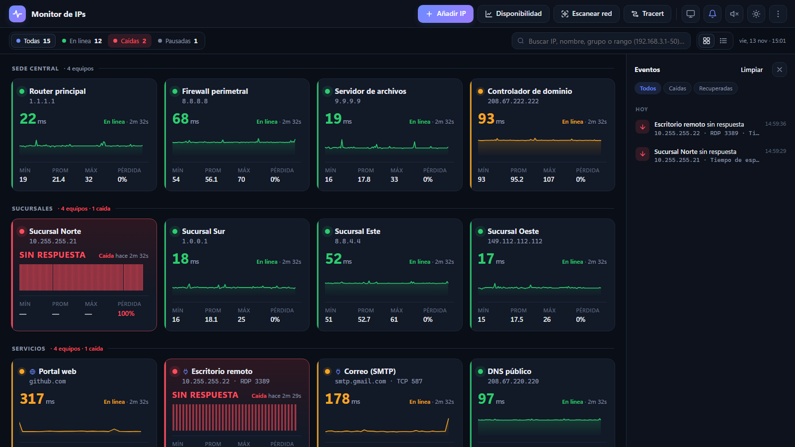
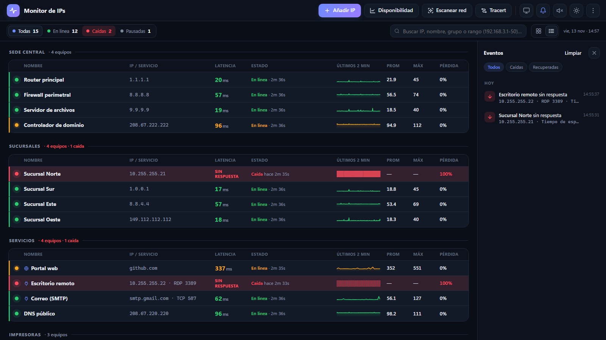
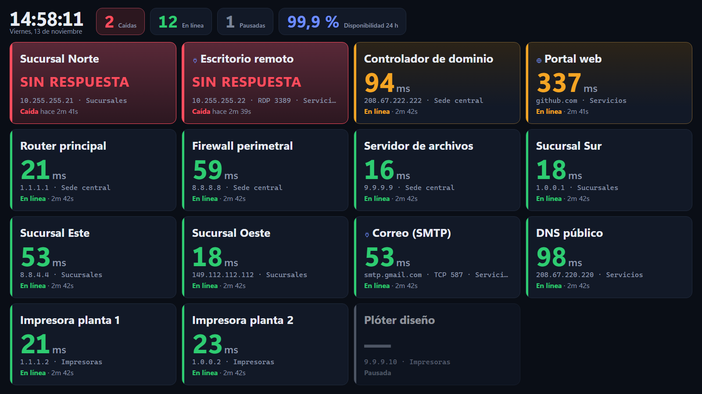
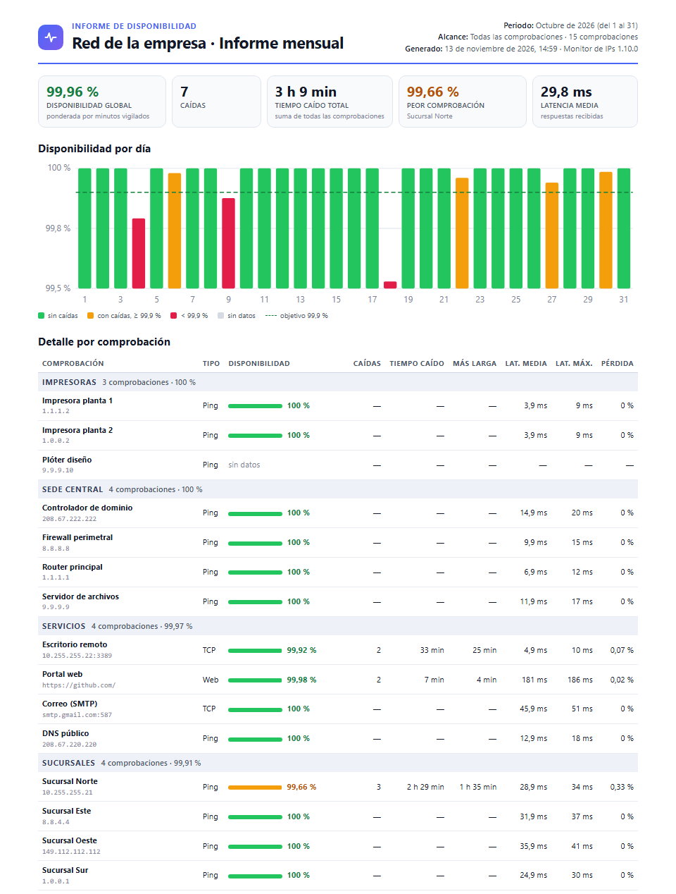
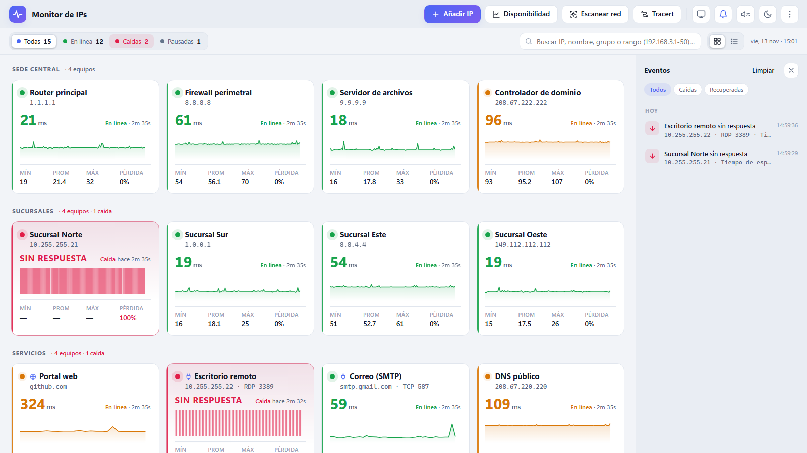

# Monitor de IPs

[](../../releases/latest)
[](../../releases)
[](LICENSE)


Monitor para Windows que vigila **varias IPs y servicios a la vez** (ping, puertos TCP y webs HTTP/HTTPS), avisa de las caídas en pantalla, en la bandeja y **por Telegram**, guarda el historial y genera **informes PDF de disponibilidad**. Incluye además tracert y escaneo de red.

Se distribuye como **instalador** o como **portable** (un único `.exe` de unos 340 KB, sin instalar nada). Usa .NET Framework 4 y Microsoft Edge, que ya vienen con Windows 10 y 11.

**[⬇ Descargar la última versión](../../releases/latest)** · [Historial de cambios](CHANGELOG.md)



## Contenido

- [Funciones](#funciones)
- [Capturas](#capturas)
- [Descargas](#descargas)
- [Uso](#uso)
- [Datos y privacidad](#datos-y-privacidad)
- [Desarrollo](#desarrollo)
- [Licencia](#licencia)

## Funciones

| | |
|---|---|
| **Ping continuo** | Una tarjeta por IP con latencia actual, gráfica de los últimos 2 min, mín/prom/máx y % de pérdida. Verde = en línea, ámbar = latencia alta o pérdidas, rojo = caída. |
| **Servicios (TCP y web)** | Comprueba un **puerto TCP** (escritorio remoto, SQL, impresora…) o una **web** (código HTTP, texto esperado y certificado HTTPS con aviso de caducidad). "Detectar puertos abiertos" encuentra los servicios de un equipo con un clic. La tarjeta muestra la causa del fallo: puerto cerrado, sin respuesta, HTTP 503… |
| **Vista de lista** | Alterna con las tarjetas: una fila por comprobación con minigráfica, ordenable por nombre, latencia, estado o pérdida. Tecla `V`. |
| **Modo pantalla (NOC)** | Para un monitor de pared: reloj, contadores grandes y disponibilidad de 24 h, con un mosaico que siempre cabe en pantalla y pone **las caídas primero**. Mantiene la pantalla encendida. Tecla `M`. |
| **Alertas** | Tras N fallos seguidos (3 por defecto, o propios de cada comprobación) pasa a *caída*: aviso en pantalla, pitido, contador en el título y notificación de Windows, también con la ventana cerrada. Al recuperarse indica cuánto duró. |
| **Avisos por Telegram** | Caídas, recuperaciones y certificados en tu móvil o en un grupo, con tu propio bot. Agrupa los eventos simultáneos, puede avisar sólo si la caída dura más de X minutos, filtra por grupos y tiene horas de silencio. Sin internet, los avisos esperan y se envían al volver. |
| **Historial y disponibilidad** | Historial por minuto de cada comprobación (24 h, 7 y 30 días): % de disponibilidad, caídas, tiempo caído y latencias. Vista "Disponibilidad" de todas, con exporte a CSV. |
| **Informe PDF** | Informe listo para enviar (mes anterior, este mes, 24 h, 7 o 30 días o fechas a elegir; todas o un grupo): resumen, gráfica, detalle por comprobación y registro de caídas. |
| **Tracert y escaneo** | Tracert salto a salto en vivo. Escaneo de rangos (`192.168.3.1-254`, `192.168.3.0/24`…) con nombre, MAC y latencia, que añade las IPs encontradas con un clic. |
| **Organización** | Grupos, búsqueda por texto o rango de IPs, filtros por estado, pausa, papelera de 30 días y deshacer. |
| **Bandeja y arranque** | Sigue vigilando en la bandeja al cerrar la ventana y puede iniciarse con Windows. Avisa cuando hay una versión nueva. |
| **Interfaz** | Tema oscuro y claro, diseño adaptable y atajos: `N` añadir, `Ctrl+F` buscar, `V` vista, `M` modo pantalla. |

## Capturas

| Vista de lista | Modo pantalla (NOC) |
|---|---|
|  |  |

| Informe PDF de disponibilidad | Tema claro |
|---|---|
|  |  |

<sub>Capturas con datos de ejemplo.</sub>

## Descargas

Cada versión se publica en **[Releases](../../releases/latest)**:

| Archivo | Cuándo usarlo |
|---|---|
| `MonitorIPs-<versión>-Setup.exe` | **Instalador.** Menú Inicio, acceso directo, desinstalador y actualización encima de la versión anterior. No pide permisos de administrador. |
| `MonitorIPs-<versión>-Portable.exe` | **Portable.** Un solo archivo, sin instalar: ideal para USB o carpetas compartidas. |
| `MonitorIPs-<versión>-Portable.zip` | El portable comprimido, con `LEEME.txt` y la licencia. |
| `SHA256SUMS.txt` | Huellas SHA-256 para verificar las descargas. |

> La primera vez, Windows puede mostrar **"Windows protegió su PC"** porque los ejecutables no llevan firma digital: *Más información → Ejecutar de todas formas*.

Requisitos: Windows 10 u 11, .NET Framework 4.x y Microsoft Edge (incluidos en Windows; sin Edge se usa Chrome, Brave o el navegador predeterminado).

## Uso

1. **Instalador:** ejecuta el Setup y abre *Monitor de IPs* desde el menú Inicio. **Portable:** abre el `.exe` con doble clic.
2. Se abre una ventana propia (Edge en modo aplicación). Pulsa **Añadir IP** o **Escanear red** para empezar.
3. **Al cerrar la ventana sigue vigilando en la bandeja** (junto al reloj): punto rojo si hay caídas, clic para abrir y clic derecho para pausar, silenciar o salir. Para que cerrar la ventana cierre el monitor, desactiva *Ajustes → Seguir en la bandeja al cerrar*.

### Avisos por Telegram

Menú ⋮ → **Avisos por Telegram…**:
1. En Telegram, abre **@BotFather**, escribe `/newbot` y pega en el monitor el token que te da. Pulsa **Conectar**.
2. Escribe `/start` a tu bot (o añádelo a un grupo) y pulsa **Detectar chats**.
3. Elige qué avisar, pulsa **Enviar mensaje de prueba**, activa y guarda.

### Informe PDF

Menú ⋮ → **Informe PDF…** (o el botón de la ventana *Disponibilidad*): elige periodo, comprobaciones y título, pulsa **Guardar PDF…** y elige nombre y carpeta. Si está marcada *Abrir el PDF al terminar*, se abre al acabar.

### Exportar

Los exportes CSV (menú ⋮ y ventana *Disponibilidad*) y el informe PDF abren el cuadro **Guardar como** de Windows en la última carpeta que usaste. Al guardar aparece un aviso con **Abrir** y **Mostrar en la carpeta**. Si prefieres que se guarden directamente en la carpeta `exports`, desactiva *Ajustes → Preguntar dónde guardar los exportes*.

## Datos y privacidad

| | Instalado | Portable |
|---|---|---|
| Carpeta de datos | `%APPDATA%\MonitorIPs` | Junto al `.exe` (o `%APPDATA%\MonitorIPs` si no se puede escribir) |
| Al actualizar o desinstalar | Se conservan | Se conservan mientras no borres la carpeta |

| Archivo | Contenido |
|---|---|
| `config.json` | Comprobaciones, grupos, papelera y ajustes. Se puede editar a mano o copiar a otro PC. |
| `history\AAAA-MM-DD.csv` | Historial por minuto (90 días por defecto, ajustable). |
| `logs\eventos-AAAA-MM-DD.csv` | Caídas, recuperaciones y cambios del día. |
| `exports\` | Carpeta propuesta la primera vez para exportes CSV e informes PDF. |

- La interfaz sólo escucha en `localhost`, en un puerto aleatorio y con un token por sesión.
- A internet sólo salen las comprobaciones que configures, la consulta diaria de versión nueva a GitHub (desactivable) y, si los activas, los avisos a `api.telegram.org`. El token del bot se guarda cifrado con DPAPI.
- Detalles y cómo avisar de un problema de seguridad: [SECURITY.md](SECURITY.md).

## Desarrollo

No hace falta Visual Studio ni el SDK de .NET: se compila con el `csc.exe` que trae Windows.

```bat
build.bat
```

El resultado queda en `dist\MonitorIPs.exe` (si falta `src\app.ico`, lo genera `tools\make-icon.ps1`).

**Publicar una versión** (requiere [Inno Setup 6](https://jrsoftware.org/isinfo.php) y GitHub CLI con sesión iniciada):
1. Sube la versión en `src\Program.cs` (`const string Version` y atributos de ensamblado) y añade su sección en `CHANGELOG.md`.
2. `.\release.ps1` genera instalador, portables y SHA256SUMS en `dist\release\<versión>\` para revisarlos.
3. Con los cambios ya en `main`, `.\release.ps1 -Publish` crea la etiqueta `v<versión>` y la Release.

**Variables de entorno para pruebas** (no se usan en el día a día):

| Variable | Efecto |
|---|---|
| `MONITORIPS_NOPDF=1` | El informe se guarda como HTML en lugar de PDF (prueba el plan B sin navegador). |
| `MONITORIPS_TG_API=http://localhost:18080` | Envía los avisos de Telegram a un servidor simulado en lugar de `api.telegram.org`. |

```
MonitorIPs.exe (C#, .NET Framework 4)
 ├─ Servidor HTTP local (HttpListener, sólo localhost + token por sesión)
 │   ├─ /        → interfaz web embebida (src/web/index.html)
 │   └─ /api/*   → estado, comprobaciones, historial, informes, Telegram, ajustes…
 ├─ Un hilo por comprobación (ping, TCP o web)
 └─ Abre Edge en modo --app apuntando al servidor local
```

| Archivo | Responsabilidad |
|---|---|
| `src/Program.cs` | Arranque, instancia única, servidor HTTP, rutas de la API, ventana y ciclo de vida. |
| `src/Monitor.cs` | Motor de comprobaciones, muestras, estadísticas, caídas, eventos y papelera. |
| `src/Checks.cs` | Ping, puerto TCP, web (HTTP/HTTPS y certificados) y detección de puertos. |
| `src/History.cs` | Historial por minuto en disco, disponibilidad, caídas y datos de informes. |
| `src/Report.cs` | Informe de disponibilidad: HTML A4 impreso a PDF con Edge en modo headless. |
| `src/Telegram.cs` | Avisos por Telegram: cola, agrupación, retraso mínimo, silencio, reintentos y token cifrado. |
| `src/Tray.cs` | Icono y menú de la bandeja, notificaciones, enfoque de la ventana e inicio con Windows. |
| `src/Dialogs.cs` | Cuadro "Guardar como" de Windows para exportes e informes, delante de la ventana del monitor. |
| `src/Updater.cs` | Aviso de versión nueva (GitHub Releases, sólo lectura). |
| `src/Tracer.cs` · `src/Scanner.cs` | Tracert y escáner de rangos IPv4 (ping + ARP). |
| `src/Config.cs` | Modelo de configuración, guardado atómico, logs CSV y utilidades. |
| `src/web/index.html` | Interfaz completa (HTML + CSS + JS, sin dependencias externas). |
| `build.bat` · `release.ps1` | Compilación y publicación. |
| `installer/` | Instalador (Inno Setup), `LEEME` del portable y plantilla de notas de la Release. |

¿Ideas o errores? Abre una [incidencia](../../issues/new/choose).

## Licencia

[MIT](LICENSE) © 2026 hujeanpaes
